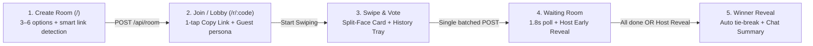

# ⚡ Decision Room — Disposable Group Decision Rooms

[](https://swipe-decision-room.netlify.app)
[](https://react.dev)
[](https://www.typescriptlang.org/)
[](https://tailwindcss.com/)
[](https://docs.netlify.com/blobs/overview/)

**End group-chat indecision in 60 seconds.**  
**Decision Room** is a zero-login, mobile-first web app built for couples, friend groups, and teams to quickly settle *"Where should we eat?"*, *"Which movie tonight?"*, or *"What's the weekend plan?"*. Drop 3 to 6 options into a disposable room, paste one short link into the group chat, and let everyone swipe.

🔗 **Live Demo:** **[https://swipe-decision-room.netlify.app](https://swipe-decision-room.netlify.app)**

---

## ✨ Why Decision Room?

Group chats stall out when everyone replies *"I'm good with whatever"*. Polls feel like work, and food/movie apps require accounts or app installs. **Decision Room** treats group choices as ephemeral, tactile micro-sessions:

- **Zero Accounts, Zero Friction:** Join via `/r/:code` with an optional display name or an auto-assigned guest animal persona (*Guest Panda*, *Guest Fox*, *Guest Otter*, etc.).
- **Split-Face Decision Card + Live Votes History Tray:**
  - **Tactile Card Physics:** Drag left (`PASS ✕`) or right (`PICK ✓`) with spring snap-back and dynamic stamp opacity, or use the docked two-tone **✕ Pass / ✓ Pick** footer.
  - **Pointer Drag-Guard:** Thumb taps on the docked footer buttons or external URL chips (`🔗 Open link ↗`) are isolated from card pointer capture so mobile taps never trigger accidental drags.
  - **Live Votes History Tray:** A compact chip tray underneath the active card lets voters tap any previously swiped option to flip `Pick ↔ Pass` in place—plus one-tap `↶ Undo` and desktop keyboard shortcuts (`←` Pass, `→` Pick, `Z` Undo).
- **Single-POST Vote Batching:** Card swipes, undos, and tray toggles happen instantaneously in local React state and submit in a single `POST /api/room` request once the final card is swiped.
- **Smart Short-Polling & Automatic Tie-Breaking:**
  - Lightweight `1.8s` short-polling runs only while a room is open and **stops immediately** once a winner is revealed.
  - Ties at the top score (or `0`-pick all-pass rounds) are resolved automatically via a deterministic room-seeded tie-breaker with a clear explanation banner.
- **Disposable by Design (60-Min TTL):** Rooms auto-expire and delete themselves from storage after 60 minutes.

---

## 🧭 User Flow & Architecture



### Tech Stack (Engineered for Netlify Free Tier)

| Layer | Technology | Role |
| :--- | :--- | :--- |
| **Frontend** | React 19, TypeScript, Vite 8 | Fast SPA with history routing (`/r/:code`) and `sessionStorage` refresh safety |
| **Styling & Motion** | Tailwind CSS v4 (`@theme`) | *Playful Tactile Utility* palette (`#FAF8F5` paper canvas, `#FF5A36` electric coral, `#141413` ink) |
| **Serverless API** | Netlify Functions (`netlify/functions/room.mts`) | Custom `/api/room` endpoint handling room creation, joins, batched votes, and early reveal |
| **Persistence** | Netlify Blobs (`@netlify/blobs`) | Strong-consistency key-value store isolated by deploy context (`decision-rooms-prod` vs `preview`) |

---

## 📂 Project Structure

```text
decision-room/
├── netlify/
│   └── functions/
│       └── room.mts              # Serverless API (/api/room) + Netlify Blobs adapter
├── public/
│   └── favicon.svg               # Brand icon
├── scripts/
│   ├── deploy.mjs                # Type-check, unit test, Vite build & Netlify deploy runner
│   ├── dev-server.mjs            # Local Vite + /api/room Netlify Function dev server
│   └── verify-room-logic.mjs     # Unit & deterministic tie-breaker test suite
├── src/
│   ├── App.tsx                   # 6-screen responsive state machine & swipe physics
│   ├── index.css                 # Tailwind v4 @theme tokens & reduced-motion rules
│   ├── main.tsx                  # App entry point
│   ├── roomLogic.ts              # Pure domain logic: URL parser, tallying & tie-breakers
│   └── types.ts                  # Shared TypeScript interfaces
├── netlify.toml                  # Netlify build config & /r/* SPA redirect rule
└── package.json
```

---

## 🚀 Getting Started Locally

### Prerequisites
- **Node.js 22+** (or Node 24) and **npm**

### 1. Install & Run Local Dev Server
```bash
git clone https://github.com/Joaolfelicio/decision-room.git
cd decision-room
npm install
npm run dev
```
This starts the local Vite dev server together with the `/api/room` serverless handler (backed by a local file/memory store when running outside Netlify) at `http://localhost:5179`.

### 2. Run Verification & Production Build
```bash
# Run unit & tie-breaker tests
npm run check

# Run unit tests + TypeScript compiler check + Vite production bundle
npm run build
```

### 3. Test Multi-Participant Sync (Two Devices or Two Tabs)
- **Two Real Devices:** Open [https://swipe-decision-room.netlify.app](https://swipe-decision-room.netlify.app), create a room, tap **Copy Link**, and open that URL on a second phone or laptop.
- **Two Tabs in One Browser:** Open `/r/:code` in Tab 1 (Host) and `/r/:code?user=2` in Tab 2 (Guest). Passing `?user=2` isolates `sessionStorage`/`localStorage` keys so you can test two independent voters side by side.

---

## 📄 License

Released under the [MIT License](./LICENSE).
